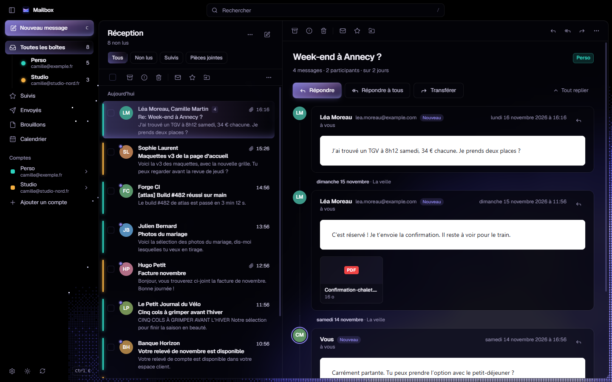
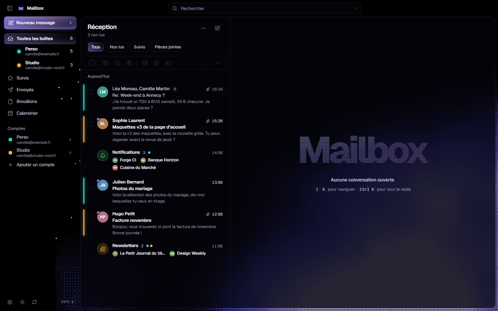
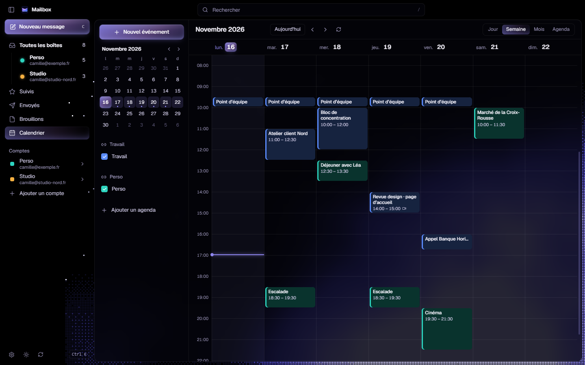
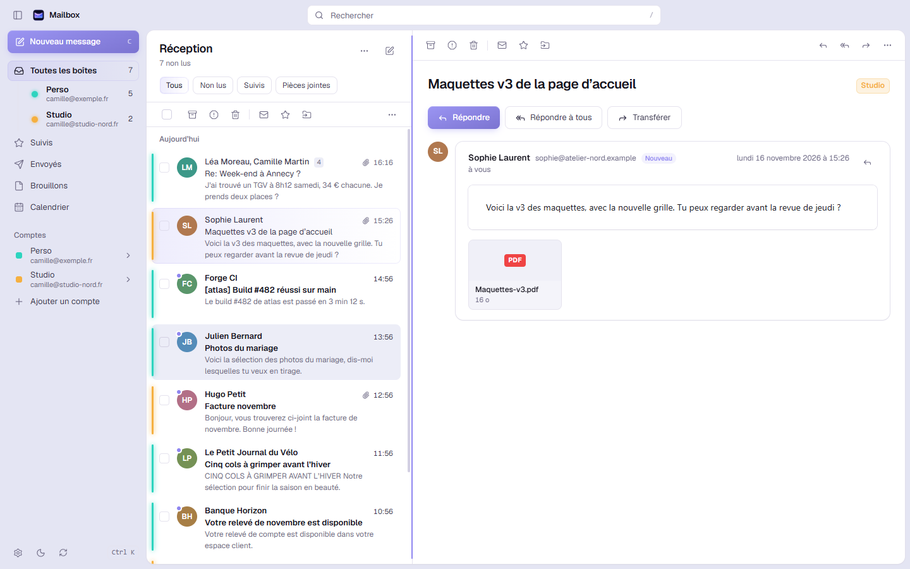
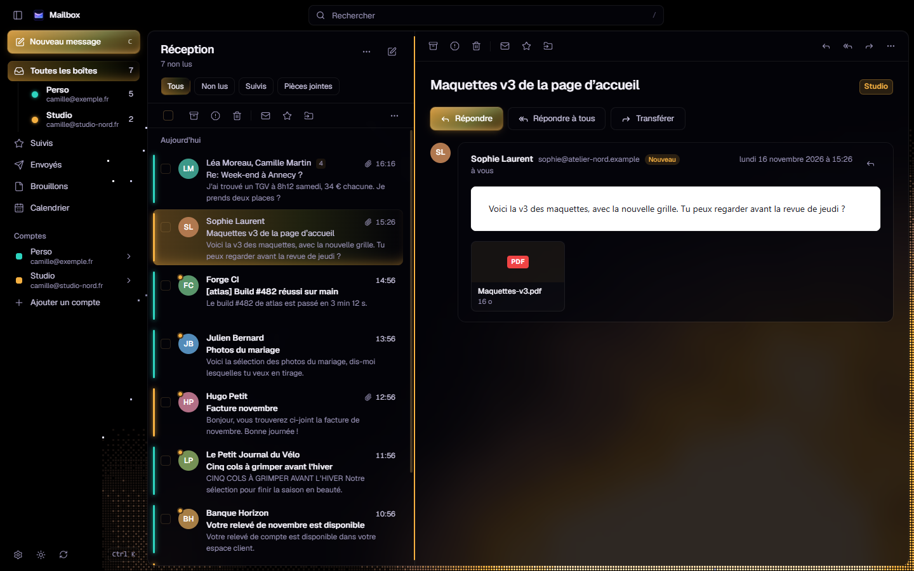
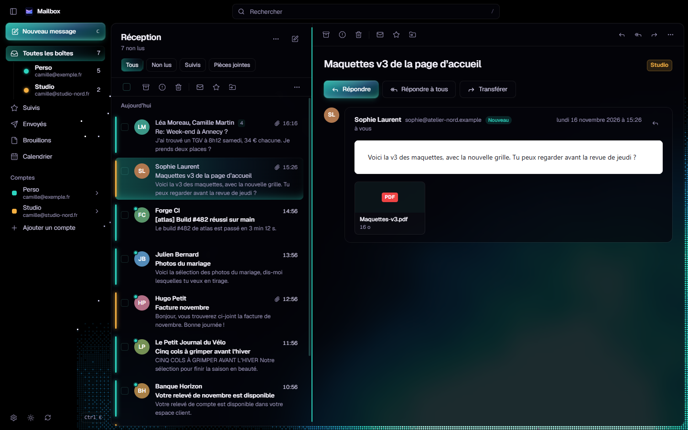
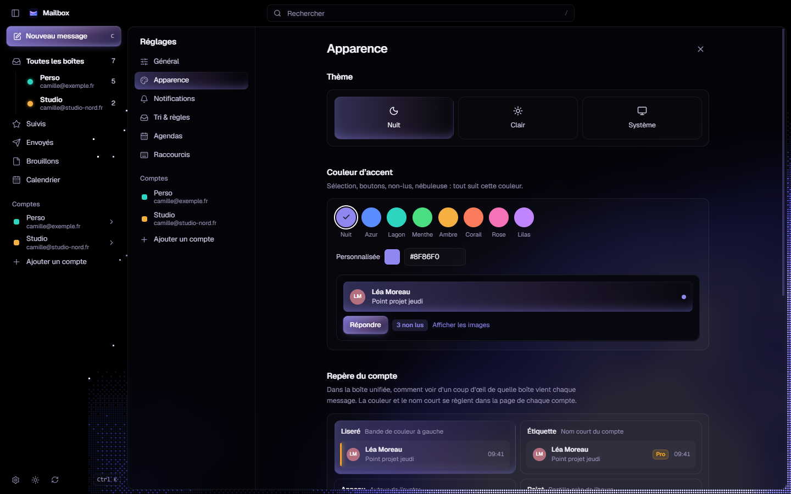

<p align="center">
  
</p>

<h1 align="center">Mailbox</h1>

<p align="center">
  Vos mails et votre agenda au même endroit, pensés clavier d’abord.<br>
  Gmail, IMAP et CalDAV, sans serveur intermédiaire : tout reste sur votre machine.
</p>

<p align="center">
  <a href="https://github.com/HowWhat42/mailbox/releases/latest"><b>Télécharger pour Windows et macOS</b></a>
  ·
  <a href="https://mailbox-app.pages.dev/privacy">Confidentialité</a>
</p>

<p align="center">
  
</p>

## En images

**Tri intelligent.** Les personnes d’abord ; notifications et newsletters regroupées, résumées par expéditeur, à traiter d’un clic.



**Agendas réunis.** Google, CalDAV et abonnements .ics côte à côte, chacun sa couleur, avec un bouton pour rejoindre les visios.



**Thème clair, ou nuit avec la couleur d’accent de votre choix.** Chaque compte garde sa couleur et son étiquette dans la boîte unifiée.

<table>
  <tr>
    <td></td>
    <td></td>
  </tr>
  <tr>
    <td></td>
    <td></td>
  </tr>
</table>

<sub>Captures générées depuis des données de démonstration : <code>pnpm build && node scripts/screenshots.mjs</code>.</sub>

## Démarrer

```bash
pnpm install
pnpm dev
```

Node 22+ et pnpm 11 requis. Aucune compilation native : la base locale utilise `node:sqlite` intégré à Electron.

### Comptes Gmail / Google Workspace

La connexion Google passe par OAuth (navigateur système, PKCE, redirection loopback). Il faut un client OAuth à vous :

1. [console.cloud.google.com](https://console.cloud.google.com) → nouveau projet ; activer **Gmail API** et **Google Calendar API**.
2. **Google Auth Platform** : audience « Externe », page d’accueil et règles de confidentialité renseignées (domaine vérifié dans Search Console), puis **Publier l’application**. En mode Test, Google coupe l’accès au bout de 7 jours.
3. **Clients** → créer un client de type **Application de bureau**.
4. Copier `.env.example` en `.env` et renseigner `MAIN_VITE_GOOGLE_CLIENT_ID` / `MAIN_VITE_GOOGLE_CLIENT_SECRET` (secrets `GOOGLE_CLIENT_ID` / `GOOGLE_CLIENT_SECRET` du dépôt pour les versions publiées).

Sans validation Google, l’accès complet à Gmail est bloqué pour les adresses @gmail.com : ajoutez ces boîtes en **IMAP** avec un [mot de passe d’application](https://myaccount.google.com/apppasswords), et Google Agenda via Réglages › Agendas (accès agenda seul).

### Autres comptes (IMAP)

Adresse + mot de passe suffisent dans la plupart des cas : les serveurs sont détectés comme dans Thunderbird (autoconfig du fournisseur puis base ISPDB de Mozilla).

### Agendas

Calendrier › **Ajouter un agenda**, indépendamment des comptes mail :

- **Google Agenda** : tous les agendas d'un compte Google, lecture et écriture (les comptes Gmail ajoutés en mail apportent aussi les leurs).
- **CalDAV** : iCloud (mot de passe pour app), Nextcloud, Fastmail, Infomaniak, Radicale…
- **Abonnement .ics** : agenda Outlook / Office 365 publié (Paramètres › Calendrier › Calendriers partagés › Publier), jours fériés, plannings partagés. Lecture seule.

Microsoft 365 en lecture-écriture (Graph) n'est pas encore pris en charge : il demande une application Azure AD.

## Raccourcis

| Touche                           | Action                                             |
| -------------------------------- | -------------------------------------------------- |
| `Ctrl K`                         | Palette de commandes                               |
| `J` / `K`                        | Conversation suivante / précédente                 |
| `E`                              | Archiver                                           |
| `#` / `Suppr`                    | Supprimer                                          |
| `S`                              | Suivre / ne plus suivre                            |
| `U`                              | Lu / non lu                                        |
| `!`                              | Indésirable                                        |
| `V`                              | Déplacer vers un dossier                           |
| `X`                              | Cocher la conversation                             |
| `Z`                              | Annuler la dernière action                         |
| `Ctrl \`                         | Afficher / masquer la barre latérale               |
| `R` / `A` / `F`                  | Répondre / répondre à tous / transférer            |
| `C`                              | Nouveau message                                    |
| `/`                              | Rechercher                                         |
| `Ctrl Entrée`                    | Envoyer                                            |
| `G` puis `I` `S` `T` `D` `C`     | Réception, suivis, envoyés, brouillons, calendrier |
| Calendrier : `T` `D` `W` `M` `A` | Aujourd'hui, jour, semaine, mois, agenda           |
| Calendrier : `N` `←` `→`         | Nouvel événement, période précédente / suivante    |

## Ce qui est là

- Boîte de réception unifiée multi-comptes, conversations groupées, couleur par compte.
- Synchronisation IMAP incrémentale + IDLE (nouveaux messages en direct, notifications système).
- Recherche plein texte locale instantanée (SQLite FTS5, insensible aux accents).
- Lecture hors ligne des messages déjà ouverts.
- HTML des mails isolé : DOMPurify + iframe sans scripts + CSP ; images distantes bloquées par défaut (pixels espions).
- Éditeur riche, pièces jointes, réponses avec citation.
- Signatures en texte ou en HTML (collé depuis un générateur), avec aperçu ; elles suivent le compte d’envoi choisi.
- Modèles par compte : objet, destinataires et texte prêts à l’emploi, avec des champs `{{Prénom}}` demandés à l’insertion ; « Enregistrer ce message comme modèle » depuis le composeur.
- Calendrier façon Outlook : plusieurs agendas (Google, CalDAV, abonnements .ics) superposés, vues jour / semaine / mois / agenda, mini-calendrier, couleur par agenda.
- Réunions en ligne détectées (Teams, Meet, Zoom, Webex, Jitsi…) avec bouton **Rejoindre** sur l'événement, dans l'aperçu, la vue agenda et l'encart « prochain événement ».
- Invitations : participants et leurs réponses, Accepter / Provisoire / Refuser (Google et CalDAV).
- Rappels dans une fenêtre flottante toujours au premier plan (même au-dessus d'une app en plein écran), sans voler le focus : Rejoindre, Rappeler dans 5 / 15 min, Ignorer. Délai de l'événement, sinon celui des réglages ; les visios sonnent aussi au début.
- Fonctionne en arrière-plan depuis la barre des tâches (option), lancement au démarrage (version installée).
- Brouillons enregistrés automatiquement sur le serveur ; archiver, supprimer et abandonner un brouillon s'annulent (`Z`) pendant 5 s.
- Destinataires en pastilles avec autocomplétion, déplacement vers un dossier, sélection multiple, menu contextuel.
- Tri intelligent façon Spark : les messages de personnes dans la liste, Notifications / Newsletters / Invitations regroupées en lignes résumées par expéditeur (tout marquer lu, tout archiver), règles personnalisables, désabonnement en un clic.
- Réglages complets : par compte (notifications, boîte unifiée, profondeur de synchro), par agenda (rappels), apparence (couleur d'accent, thème, fond, densité, taille de l'interface), heures calmes, démarrage avec Windows.
- Interface responsive : sidebar en rail puis en tiroir, un seul panneau sous 1100 px, calendrier en 3 jours sur fenêtre étroite.
- Thème « nuit » (nébuleuse pixélisée générée au lancement) et thème clair. Mots de passe et jetons chiffrés par le trousseau de l'OS (`safeStorage`).

## Limites connues

- Première synchro : les 400 messages les plus récents par dossier. La recherche ne couvre que ce qui est en local.
- Gmail « Tous les messages » n'est pas synchronisé (doublons des libellés) ; l'archivage y déplace bien les messages.
- CalDAV : modifier une occurrence d'un événement récurrent n'est pas pris en charge ; la suppression et la réponse à une invitation s'appliquent à toute la série.
- Rappels : pas pour les événements « toute la journée ».

## Installeurs Windows et macOS, mises à jour

```bash
pnpm dist              # installeur local : dist/Mailbox-Setup-<version>.exe (non signé)
pnpm dist:mac          # sur un Mac : dist/Mailbox-<version>-arm64.dmg et -x64.dmg (signature ad hoc)
pnpm release           # publie une version : patch par défaut, ou `pnpm release minor|major`
```

Les nouveautés s’écrivent au fil de l’eau dans [`CHANGELOG.md`](CHANGELOG.md), sous « ## À venir », pour les personnes qui
utilisent l’app. `pnpm release` refuse de publier si cette section est vide ; sinon elle devient « ## X.Y.Z — date », sert de
notes à la Release GitHub, et s’affiche dans l’app (« Voir les nouveautés ») quand la mise à jour est prête.

`pnpm release` vérifie que `main` est propre et à jour, lance `pnpm check`, monte la version, commit,
tague `vX.Y.Z` et pousse. Le workflow **Release** construit l’installeur Windows et les images disque macOS (Apple Silicon et
Intel) en parallèle, les publie dans une même GitHub Release (avec `latest.yml` / `latest-mac.yml` et
les blockmaps) et attache une attestation de provenance
(`gh attestation verify Mailbox-Setup-X.Y.Z.exe -R HowWhat42/mailbox`). La Release n’est publiée que si
les deux builds ont réussi.

Les apps installées vérifient au démarrage puis toutes les 4 heures, téléchargent en arrière-plan et
affichent « Mise à jour prête » dans la barre latérale : un redémarrage l’installe (sinon elle
s’installe à la prochaine fermeture). Réglages › Général › Mises à jour montre la version et permet de
chercher tout de suite. Sur Mac, l’app n’étant pas signée, macOS refuse d’installer une mise à jour :
elle est seulement annoncée (« Mise à jour disponible »), et « Télécharger » ouvre la page de la
Release.

Secrets du dépôt (optionnels) : `GOOGLE_CLIENT_ID` et `GOOGLE_CLIENT_SECRET`, injectés au build pour
activer la connexion Google dans l’app installée.

**Signature** : l’installeur n’est pas signé. Au premier install sur un PC, SmartScreen affiche
« Windows a protégé votre ordinateur » → _Informations complémentaires_ → _Exécuter quand même_ ; les
mises à jour suivantes passent sans avertissement. Pour signer plus tard (Azure Artifact Signing),
ajouter `build.win.sign` (`type: "azure"`, `publisherName`, `endpoint`, `codeSigningAccountName`,
`certificateProfileName`) et les secrets `AZURE_TENANT_ID` / `AZURE_CLIENT_ID` / `AZURE_CLIENT_SECRET`
au job de release ; electron-updater vérifiera alors l’éditeur des mises à jour.

**macOS** : sans compte Apple Developer, l’app n’est signée qu’ad hoc et pas notarisée. Prendre le
`.dmg` `arm64` (Apple Silicon) ou `x64` (Intel), glisser Mailbox dans Applications ; au premier
lancement macOS la bloque. Soit Réglages Système › Confidentialité et sécurité › _Ouvrir quand même_,
soit en Terminal :

```bash
xattr -dr com.apple.quarantine /Applications/Mailbox.app
```

Pour signer et notariser plus tard (et retrouver les mises à jour automatiques) : certificat
Developer ID Application en secrets `CSC_LINK` / `CSC_KEY_PASSWORD`, `APPLE_ID` /
`APPLE_APP_SPECIFIC_PASSWORD` / `APPLE_TEAM_ID`, retirer `mac.identity: "-"` et le
`CSC_IDENTITY_AUTO_DISCOVERY: false` du workflow, et `MANUAL` dans `src/main/updater.ts`.

Le dev (`pnpm dev`) garde ses données dans `%APPDATA%\Mailbox Dev`, à part de l’app installée.

## Tests

```bash
pnpm typecheck
pnpm run lint            # oxlint
pnpm run format          # oxfmt (format:check en CI)
pnpm test:e2e            # boîte jetable Ethereal : synchro, threads, PJ, envoi, archive, recherche
pnpm test:e2e:calendar   # Radicale local : sources CalDAV + .ics, récurrences, réponse, rappel flottant, Rejoindre
pnpm test:e2e:triage     # tri intelligent, regroupements, règles, désabonnement, accent, zoom, démarrage avec Windows
pnpm test:e2e:responsive # redimensionne la fenêtre de 1440 à 480 px, vérifie l'absence de débordement
pnpm test:e2e:templates  # signature HTML + aperçu, modèle avec champs inséré, envoyé et relu
pnpm test:e2e:update     # installeur 9.9.9 servi en local : détection, téléchargement, « Mise à jour prête »
pnpm test:e2e:mcp        # serveur MCP : jeton, Origin/Host refusés, verrouillage, outils selon les permissions
```

## Accès IA (MCP)

Mailbox peut exposer un serveur [MCP](https://modelcontextprotocol.io) local pour qu'un assistant IA (Claude Code, Claude Desktop, Cursor…) lise vos mails et votre agenda. Désactivé par défaut : **Réglages › Accès IA**.

```bash
# commande copiée depuis Réglages › Accès IA › Copier la commande
claude mcp add --transport http mailbox http://127.0.0.1:47811/mcp --header "Authorization: Bearer mbx_…"
```

| Niveau   | Outils                                                                                                              | Réglage                                  |
| -------- | ------------------------------------------------------------------------------------------------------------------- | ---------------------------------------- |
| Lecture  | `list_accounts`, `list_folders`, `search_threads`, `get_thread`, `search_contacts`, `list_calendars`, `list_events` | serveur actif                            |
| Écriture | `create_draft`, `update_thread` (lu, suivi, archiver), `create_event` (sans invité)                                 | « Brouillons, classement et événements » |
| Envoi    | `send_message`, confirmé par l'utilisateur dans une fenêtre de Mailbox (2 min, sinon rien ne part)                  | « Envoi de messages »                    |

Protections : écoute sur `127.0.0.1` uniquement ; jeton de 256 bits chiffré par le système (DPAPI / Trousseau), comparé en temps constant ; toute requête avec un en-tête `Origin` (navigateur) ou un `Host` étranger (DNS rebinding) refusée ; verrouillage d'une minute après 5 jetons invalides ; 120 requêtes/min ; corps limité à 1 Mo ; aucune pièce jointe, suppression, vidage de dossier, compte ou réglage accessible ; contenu des mails signalé à l'IA comme données non fiables ; journal d'activité dans les réglages. Le port par défaut est 47811 (47812 pour une version de développement).

## Architecture

```
src/main/        process Electron : SQLite, IMAP (imapflow), SMTP (nodemailer), OAuth Google, CalDAV (tsdav + ical.js)
src/preload/     pont IPC typé exposé en window.mailbox
src/shared/      contrat de types partagé main ⇄ UI
src/renderer/    React 19 + Tailwind 4 + zustand
tests/           tests E2E Playwright pilotant l'app réelle
```
